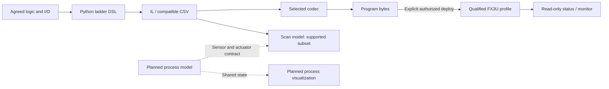

# PLC Workbench

**Language:** **English** | [Polski](README.pl.md)

PLC Workbench is an experimental Python toolchain for Mitsubishi **FX3U** PLCs.
It communicates through the built-in round programming port (RS-422, the same
cable GX Works2 uses) and works **without GX Works2 at runtime**. The Python
package is `fx3u-toolkit`; its command-line entrypoint is `fx3u`:

- compile instruction-list (IL) source to the PLC's program bytecode, and disassemble it back;
- cross-reference devices to PLC step numbers;
- write ladder logic in a small Python DSL, export GX Works2-importable CSV, or compile it directly;
- read status, diagnostics and device values; watch several PLCs on several COM ports;
- monitor selected devices and edit internal M/D values with a stopped readback;
- back up the program region and, when explicitly asked, deploy a new program to RAM with
  automatic backup, verification and attempted recovery.

> **Status: experimental.** Recorded hardware evidence comes from **one** FX3U
> (CPU version reply `f75e`, reported as 3.11) with one cable on Windows; it does not
> qualify every implemented feature. The client refuses other CPU versions. Read
> [SAFETY.md](SAFETY.md) before connecting to a PLC that controls anything.

Not affiliated with or endorsed by Mitsubishi Electric. See [NOTICE.md](NOTICE.md).

The [bounded device debugger](docs/device-debugger.md) documents device ranges,
one-shot FORCE semantics, backup/recovery and the effect of temporary STOP.

## Evidence and limits

Every claim carries an evidence level ([docs/evidence.md](docs/evidence.md)):

Selected RUN writes (M250, D44/D45, two M bytes and Y0) are documented in the
[bench qualification record](docs/bench-qualification-20261114.md). This does not
qualify every live-write address, CPU or physical output circuit.

- the historical 1585-instruction reference compiles **byte-identically** to the recorded PLC readback; the corrected active example is separately tested offline;
- new rungs were compiled, deployed and observed executing without GX; the original was restored;
- timers, counters, `SFTL` and `ROL` were qualified on the CPU with a dedicated lab program;
- the instruction atlas (`fx3u catalog`) lists 250 FX3U instructions and states, for each one,
  whether it is merely documented, encodable here, or functionally tested — these are different things.

## Choose the encoder

| Path | What it supports | Evidence and limits |
|---|---|---|
| `compile`, `disassemble`, default `compile-csv` | Conservative baseline: 16 mnemonics and specific operand forms/device ranges | Narrow tested encoding profile; CPU tests cover the cases recorded in the evidence page |
| `compile-experimental`, `disassemble-experimental`, `compile-csv --experimental` | Extended independent codec: 528 mnemonic names, including D/P variants and broader operand forms | Offline calibration and selected CPU cases; not blanket hardware qualification |

Both paths reject unsupported forms rather than guessing. The current catalog does
not list every extended runtime mnemonic; see [extended-codec.md](docs/extended-codec.md)
for the catalog gap. Use matching compile/disassemble modes. Extended deployment
requires explicit `--experimental`; `--full-region` additionally requires the one
qualified 32,000-byte header/checksum layout. It is not generic CPU discovery.

## Architecture

The implementation keeps source generation, encoding, analysis and transport
separate. The main modules are:

| Layer | Modules | Responsibility |
|---|---|---|
| CLI | [cli.py](src/fx3u/cli.py) | Command parsing, offline validation and operation reports |
| Ladder and CSV | [dsl/](src/fx3u/dsl/) | Named devices, reusable rung patterns and GX Works2-compatible CSV |
| Codecs | [bytecode.py](src/fx3u/bytecode.py), [experimental_codec.py](src/fx3u/experimental_codec.py) | IL/image conversion and instruction-step maps |
| Analysis and simulation | [analysis.py](src/fx3u/analysis.py), [sim.py](src/fx3u/sim.py) | Device footprints, uncertainty and explicit scan semantics |
| Programming-port transport | [client.py](src/fx3u/client.py), [layout.py](src/fx3u/layout.py) | Serialized exchanges, CPU/layout guards and program backup/deployment |
| Bounded device operations | [devices.py](src/fx3u/devices.py), [live.py](src/fx3u/live.py) | Monitoring, stopped edits and allow-listed RUN writes |
| Multiple ports | [fleet.py](src/fx3u/fleet.py) | Read-only polling of separately connected controllers |

The solid paths below describe implemented tools; the dashed process-model
and visualization paths are planned integration work.



The implemented backend targets one observed FX3U CPU/layout profile. The
direction for winding machines needs a deterministic process model, signal timing, independent
expected results and adapters for each actual CPU. FX5U and Delta DVP are not
implemented backends in this package. Additional CPU targets require exact
hardware identification, their own implementation and separate qualification.
A rendered mechanism is not evidence that its PLC timing or physical I/O works.
[Engineering decisions](docs/engineering-decisions.md) explains these boundaries.

## Install

```bash
python -m pip install -e .            # Python >= 3.10; only dependency: pyserial
fx3u --help                           # or: python -m fx3u --help
```

## Quick start: offline (any OS, no PLC)

Run these commands from the checkout root. The first command creates the output
directory; no PLC or serial port is used.

```bash
python -c "from pathlib import Path; Path('out').mkdir(exist_ok=True)"
fx3u catalog --mnemonic SFTL                      # what is known about an instruction
fx3u compile examples/count_d0.il out/p.bin       # IL -> 6096-byte program image (+ .map.json)
fx3u disassemble out/p.bin out/p.il               # and back
fx3u xref out/p.bin D0                            # where is D0 used, at which steps
fx3u compile out/p.il out/roundtrip.bin
python -c "from pathlib import Path; assert Path('out/p.bin').read_bytes() == Path('out/roundtrip.bin').read_bytes()"
```

For your own IL CSV export, use `fx3u compile-csv my_export.csv out/p.bin`.
Choose `--experimental` when its instruction forms require the extended codec.
The import checks record structure and compares every source step against the
selected encoder's instruction map before writing any output. Suspicious gaps
or mismatched instruction widths are refused, including in the example generator.
See [CSV import boundaries](docs/csv-import.md) for supported export constructs.

Python DSL → compatible IL CSV:

```python
from fx3u.dsl import Prog   # patterns include remapping, latches, timers and click commands
```

See the [lighting control case study](examples/lighting-case-study/README.md),
its [technical requirements](examples/lighting-case-study/requirements.md)
and [Polish specification](examples/lighting-case-study/requirements.pl.md).
The corrected three-station program is reproducible offline. The separate
`legacy-reference.il` matches the historical PLC readback and retains its known
click-loss defect; that readback does not qualify the corrected program.

## Live (native Windows Python, programming cable)

Close GX Works2 first: one program per COM port.

```bash
fx3u status      --port COM6 --wire-log logs/status.jsonl          # read-only
fx3u diagnostics --port COM6 --wire-log logs/diag.jsonl            # read-only
fx3u watch       --port COM6 --wire-log logs/watch.jsonl --count 10
fx3u dump        --port COM6 --wire-log logs/dump.jsonl --out-dir backup/2026-11-07
fx3u compare     --port COM6 --wire-log logs/cmp.jsonl backup/2026-11-07/program.bin
fx3u fleet-watch --config examples/fleet.example.json --out-dir logs/fleet   # several PLCs
```

Deploy is a **dry run** unless `--execute` is given, and it needs the SHA-256 of the image you
expect to be in the PLC right now (from `dump`), so you cannot overwrite a program you have not seen:

```bash
fx3u deploy --port COM6 --wire-log logs/deploy.jsonl --out-dir backup/deploy-1 \
            --expected-sha256 EXPECTED_SHA256 new.bin              # validates only
fx3u deploy ... --execute                                          # STOP, write changed blocks, verify, RUN
```

Every live command writes a JSONL wire log (new file, exclusive create) of all bytes exchanged.
Logs and backups belong outside public source history; ignoring files does not
remove data already tracked by Git or protect a forced add.

Full-region reads separate layout qualification from image integrity:
`dump --full-region` preserves raw program/header files and reports checksum
validation in `manifest.json`; a checksum mismatch returns exit2 and
`verified=false`. `compare --full-region` reports `match` separately from
`checksum_valid`, and succeeds only when both are true. These reads are not
atomic snapshots. See [extended codec and integrity](docs/extended-codec.md).

Deployment verifies changed blocks and the complete image in confirmed STOP
before RUN, then compares the complete image again after the default laboratory
resume. `--leave-stopped` suppresses RUN on success and recovery. Short extended
images require explicit `--pad-to-region`; inspect both input/candidate hashes. Failed recovery makes one best-effort STOP attempt
and independently reads the final CPU mode. A broken link can leave that mode
`unknown`; a report cannot guarantee STOP without a confirmed status read.
Program recovery covers bytes; output/device-state recovery needs a separate plan.

Full verification has a substantial timing cost: at 9600 baud, 7E1, ASCII HEX,
the response data alone needs at least **12.7 s for 6,096 bytes** or **66.7 s for
32,000 bytes**. Requests, framing, writes and adapter delays add time. These are
lower bounds, not predicted STOP durations. The historical 1.84 s bench STOP
used an earlier deployment path. Measure the current path on an authorized
bench before installation use; see [deployment timing](docs/deployment-timing.md).

## Development approach

Start with agreed requirements, an explicit I/O map and observable acceptance
cases. Agents help inspect sources, generate ladder logic, exercise the tools
and prepare changes for review. Keep program authoring, encoding checks,
simulation results and physical PLC evidence separate. Review the resulting
source and verification records before deployment; a plausible explanation or
a successful compilation is not a machine acceptance test.

Changes are checked with host tests, failure injection and reproducible examples.
Hardware trials use a defined target, a fresh backup and a recovery plan, with
human authorization for their actual device scope. Future process visualization
will consume the same modeled state and traces rather than inventing its own cycle.

## For AI agents

Three repository-local skills are available:

- [skills/fx3u-toolchain/SKILL.md](skills/fx3u-toolchain/SKILL.md): codec selection,
  offline checks and authorized deployment workflow.
- [skills/fx-plc-dsl/SKILL.md](skills/fx-plc-dsl/SKILL.md): ladder authoring with
  `fx3u.dsl`, device allocation and direct compilation.
- [skills/fx-plc-programming-comm/SKILL.md](skills/fx-plc-programming-comm/SKILL.md):
  read-only inspection and bounded edits through `fx3u.client`.

Keep this checkout available, ask your agent to read the applicable `SKILL.md`,
and give it the project source and intended target scope. Relative documentation
links resolve inside this repository. No global skill-directory change is needed.
`pip install` installs the Python toolkit, **not these skill folders**.

To make the three skills discoverable globally, install small routers pointing
to a stable canonical checkout. From that checkout:

```bash
python scripts/install-skill-routers.py                         # preview only
python scripts/install-skill-routers.py --apply                 # ~/.agents/skills
# Optional alternative agent discovery directory:
python scripts/install-skill-routers.py --skills-dir /path/to/agent/skills --apply
```

Only each skill's `SKILL.md` is replaced; original entrypoints receive a
content-addressed backup and all adjacent manuals, scripts and ANTI_RULES stay
in place. Repeating installation is a no-op when routers already match. The
installer validates all three source skills and linked references before
writing. Keep the checkout available; moving it requires rerunning the installer
from its new location. Reload skills or start a new agent session afterwards.
Use `--skills-dir /tmp/fx3u-skills-test` to preview or test an isolated directory.

Agents with another discovery directory can use `--skills-dir` or read the
canonical repository skill directly. Existing directory links to the shared
skills follow updated routers; newly added skills also need to be discoverable
by the chosen agent.

These skills default to offline work. A live write needs an explicit human
instruction; a manual entry or successful encoding is never a PLC test result.

## Tests

```bash
python -m pip install -e ".[dev]"
python -m pytest -q
python scripts/check_public.py        # full local scan requires private patterns
python scripts/check_history.py       # reachable file versions and commit metadata
```

[Host CI](.github/workflows/ci.yml) runs pytest, reproduces all three lighting
stations with reference/hash/round-trip checks, and scans current source and reachable
Git history on Ubuntu with Python 3.10 and 3.12. CI uses `--allow-missing-private`
because private user patterns are not distributed. Before publishing, run the
normal scanner locally with private patterns configured; CI's generic scan does
not replace that check. Private-corpus tests are optional and skip without their
external fixtures. CI does not open a PLC port or prove hardware behavior.

Reviewed public identity lines are recorded in
[.public-scan-allowlist.json](.public-scan-allowlist.json) by exact file or Git
identity field and SHA-256 of the entire line, excluding only its line terminator.
They waive only matching private-pattern findings. Generic checks, other lines,
other contexts and commit messages are still checked. Changes to this policy
require explicit review; it contains hashes and reasons, not the private rules.

For a separate audit of all locally reachable historical file versions, run
`python scripts/check_history.py` with private patterns configured. Review its
findings before publication; it does not inspect GitHub's PR caches or Actions
logs. See [publication checks and remaining qualification](docs/publication-audit.md),
[structured device-reference reports](docs/device-usage.md), and
[bounded write API](docs/live-api.md) for changed contracts and limits.

## Motivation and roadmap

Winding machines motivate the broader PLC Workbench direction: perforation
registration, film position and controlled deceleration need inspectable logic,
independent expected results and observable execution. The current release is
the working FX3U toolchain; a complete process model and additional PLC backends
remain planned work. The Python package stays `fx3u-toolkit` and its CLI `fx3u`.


Author and maintainer: [vova5049](https://github.com/vova5049).

## License

MIT — see [LICENSE](LICENSE).

## Experimental extended codec

`compile-experimental input.il output.bin` and `disassemble-experimental output.bin output.il`
use an independent, offline codec calibrated against a private oracle campaign.
They require no Mitsubishi software or DLLs at runtime. The existing deploy path
keeps its proven, narrow default profile. `deploy --experimental` explicitly selects
the extended decoder. A short image additionally requires `--pad-to-region`,
which explicitly fills the remainder of the selected qualified region with `0xFF`.
All expected-SHA, backup, STOP, readback and rollback checks still apply. Extended
output is not automatically qualified for hardware execution. The package profile records opcode layouts and observed
operand forms, not a claim that every instruction or physical function was tested.

The extended codec covers basic logic, word and double-word instructions, pulse
variants, device boundaries, index registers, module buffer operands and strings.
Some legacy names remain unsupported; unsupported forms raise an error.
`FX3U_EXPERIMENTAL_CORPUS` optionally enables the full private regression campaign.

The extended `--full-region` workflow is qualified on the observed 32,000-byte
program layout, including a maximum-length RAM program and verified restoration.
Its integrity checks require the qualified static header and a matching
CPU-maintained word sum; raw dumps remain available when checksum validation fails.
`simulate` provides an explicit scan-semantics subset with trace inputs; see
[the extended codec](docs/extended-codec.md) and [scan model](docs/scan-simulator.md).

`compile-csv input.csv output.bin --experimental` connects existing `fx3u.dsl`
CSV output to the extended encoder, preserving the original default codec.
