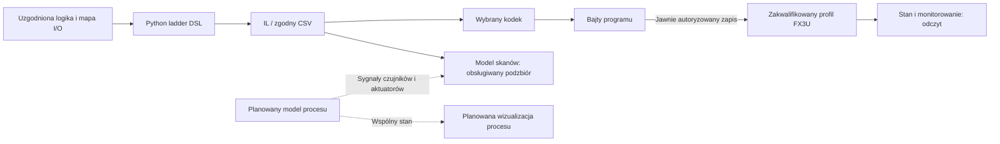

# PLC Workbench

**Język:** [English](README.md) | **Polski**

PLC Workbench to eksperymentalny zestaw narzędzi w Pythonie dla sterowników
Mitsubishi **FX3U**. Komunikuje się przez wbudowane, okrągłe złącze programowania
(RS-422, używane również przez GX Works2) i działa **bez GX Works2 podczas
wykonywania narzędzi**. Pakiet Python nazywa się `fx3u-toolkit`, a polecenie CLI
— `fx3u`:

- kompilowanie kodu w języku listy instrukcji (IL) do kodu programu PLC oraz dekompilacja;
- wyszukiwanie odwołań do urządzeń i przyporządkowanie ich do numerów kroków programu PLC;
- tworzenie logiki drabinkowej za pomocą prostego Python DSL, eksport plików CSV importowanych przez GX Works2 lub bezpośrednia kompilacja;
- odczytywanie stanu, diagnostyki i wartości urządzeń oraz monitorowanie kilku PLC przez różne porty COM;
- obserwowanie wybranych urządzeń i modyfikowanie wewnętrznych wartości M/D z zatrzymanym odczytem kontrolnym;
- tworzenie kopii obszaru programu, a po wyraźnym poleceniu użytkownika również zapis nowego programu do RAM z automatycznym backupem, weryfikacją i próbą przywrócenia poprzedniej wersji.

> **Status: eksperymentalny.** Udokumentowane testy sprzętowe dotyczą **jednego** sterownika FX3U (odpowiedź wersji CPU: `f75e`, raportowana jako 3.11) i jednego kabla pod Windows. Nie potwierdzają działania wszystkich zaimplementowanych funkcji. Klient odmawia pracy z innymi wersjami CPU. Przed podłączeniem do sterownika rzeczywistej maszyny przeczytaj [SAFETY.md](SAFETY.md) (po angielsku).

Projekt nie jest powiązany z Mitsubishi Electric ani przez tę firmę zatwierdzony. Zobacz [NOTICE.md](NOTICE.md).

Dokumentacja [debuggera urządzeń](docs/device-debugger.md) opisuje ograniczenia adresów, jednorazowe działanie FORCE, backup i odzyskiwanie oraz skutki chwilowego przełączenia sterownika w STOP.

## Dowody i ograniczenia

Każde twierdzenie o działaniu jest powiązane z poziomem dowodów ([docs/evidence.md](docs/evidence.md)).

Wybrane zapisy w RUN (M250, D44/D45, dwa bajty M i Y0) mają osobny [raport kwalifikacji na stanowisku testowym](docs/bench-qualification-20261114.md). Nie oznacza to kwalifikacji wszystkich adresów modyfikowanych w RUN, innych CPU ani fizycznych obwodów wyjść.

- Historyczny program zawierający 1585 instrukcji kompiluje się **do identycznych bajtów**, jak zapisany odczyt PLC. Poprawiony aktywny przykład ma osobne testy offline i nie jest jeszcze zakwalifikowany na sprzęcie.
- Nowe szczeble logiki skompilowano, przesłano do CPU i zaobserwowano ich wykonanie bez GX Works2. Następnie przywrócono oryginalny program.
- Timery, liczniki oraz instrukcje `SFTL` i `ROL` sprawdzono na CPU z użyciem specjalnie przygotowanego programu laboratoryjnego.
- Atlas instrukcji (`fx3u catalog`) obejmuje 250 instrukcji FX3U i dla każdej rozróżnia: obecność w dokumentacji, możliwość zakodowania oraz rzeczywisty test działania. To **trzy różne poziomy potwierdzenia**.

## Wybór kodera

| Tryb | Obsługiwany zakres | Dowody i ograniczenia |
|---|---|---|
| `compile`, `disassemble`, domyślny `compile-csv` | Zachowawczy profil podstawowy: 16 mnemoników oraz określone postacie operandów i zakresy urządzeń | Wąski profil kodowania. Testy CPU obejmują przypadki udokumentowane w `docs/evidence.md` |
| `compile-experimental`, `disassemble-experimental`, `compile-csv --experimental` | Niezależny, rozszerzony kodek: 528 nazw mnemoników, w tym warianty D/P i szerszy zakres operandów | Kalibracja offline i wybrane testy CPU. Bez ogólnej kwalifikacji sprzętowej |

Oba tryby odrzucają nieobsługiwane formy zamiast odgadywać ich kodowanie. Aktualny katalog nie wymienia wszystkich mnemoników rozszerzonego środowiska wykonawczego. Szczegóły: [extended-codec.md](docs/extended-codec.md).

Do kompilacji i dekompilacji wybieraj odpowiadające sobie tryby. Wdrożenie programu skompilowanego kodekiem rozszerzonym wymaga wyraźnego `--experimental`. Opcja `--full-region` wymaga dodatkowo jedynego zakwalifikowanego układu nagłówka i sumy kontrolnej obszaru 32 000 bajtów. Nie jest to automatyczne wykrywanie wszystkich typów CPU.

## Architektura

Implementacja rozdziela generowanie źródeł, kodowanie, analizę i transmisję.
Główne moduły:

| Warstwa | Moduły | Odpowiedzialność |
|---|---|---|
| CLI | [cli.py](src/fx3u/cli.py) | Argumenty poleceń, walidacja offline i raporty operacji |
| Drabinka i CSV | [dsl/](src/fx3u/dsl/) | Nazwane urządzenia, powtarzalne wzorce sieci i CSV zgodny z GX Works2 |
| Kodeki | [bytecode.py](src/fx3u/bytecode.py), [experimental_codec.py](src/fx3u/experimental_codec.py) | Konwersja IL/obrazu i mapy kroków instrukcji |
| Analiza i symulacja | [analysis.py](src/fx3u/analysis.py), [sim.py](src/fx3u/sim.py) | Zakresy odwołań, niepewność i jawna semantyka skanów |
| Port programowania | [client.py](src/fx3u/client.py), [layout.py](src/fx3u/layout.py) | Szeregowanie wymian, kontrola CPU/układu pamięci i backup/wdrożenie programu |
| Ograniczone operacje na urządzeniach | [devices.py](src/fx3u/devices.py), [live.py](src/fx3u/live.py) | Monitorowanie, edycja w STOP i zapisy w RUN z listą dozwolonych adresów |
| Wiele portów | [fleet.py](src/fx3u/fleet.py) | Odczyt osobno podłączonych sterowników |

Ciągłe ścieżki diagramu opisują zaimplementowane narzędzia; przerywane ścieżki
modelu procesu i wizualizacji oznaczają planowaną integrację.



Zaimplementowany backend obsługuje jeden zaobserwowany profil CPU/układu pamięci FX3U. Planowany zakres dla nawijarek wymaga deterministycznego modelu procesu, uwzględnienia czasów sygnałów, niezależnych wyników referencyjnych i adapterów dopasowanych do rzeczywistych sterowników.

**FX5U i Delta DVP nie są zaimplementowanymi backendami** tego pakietu. Kolejne sterowniki wymagają identyfikacji dokładnego modelu sprzętu, osobnej implementacji i kwalifikacji.

Wizualizacja mechanizmu nie jest dowodem poprawności czasów wykonywania programu PLC ani działania fizycznych I/O. Granice projektu opisuje [Engineering decisions](docs/engineering-decisions.md).

## Instalacja

```bash
python -m pip install -e .            # Python >= 3.10; jedyna zależność: pyserial
fx3u --help                           # alternatywnie: python -m fx3u --help
```

## Szybki start: offline (dowolny system, bez PLC)

Uruchom poniższe polecenia w głównym katalogu repozytorium. Pierwsze polecenie tworzy katalog wynikowy. Nie jest potrzebny sterownik PLC ani port szeregowy.

```bash
python -c "from pathlib import Path; Path('out').mkdir(exist_ok=True)"
fx3u catalog --mnemonic SFTL                      # informacje o instrukcji
fx3u compile examples/count_d0.il out/p.bin       # IL -> obraz programu 6096 bajtów (+ .map.json)
fx3u disassemble out/p.bin out/p.il               # dekompilacja
fx3u xref out/p.bin D0                            # gdzie i w których krokach użyto D0
fx3u compile out/p.il out/roundtrip.bin
python -c "from pathlib import Path; assert Path('out/p.bin').read_bytes() == Path('out/roundtrip.bin').read_bytes()"
```

Aby skompilować własny eksport IL CSV, użyj `fx3u compile-csv my_export.csv out/p.bin`. Wybierz `--experimental`, jeżeli postacie instrukcji wymagają kodeka rozszerzonego.
Importer sprawdza strukturę rekordów i każdy źródłowy numer kroku względem mapy
wybranego kompilatora przed zapisem wyników. Luki i niezgodne długości instrukcji
są odrzucane; ta sama kontrola obowiązuje w generatorze przykładu.
Zakres obsługiwanych eksportów opisuje [CSV import](docs/csv-import.md).

Python DSL -> zgodny plik CSV z IL:

```python
from fx3u.dsl import Prog   # m.in. mapowanie adresów, zatrzaski, timery i polecenia typu click
```

Zobacz [przykład sterowania oświetleniem](examples/lighting-case-study/README.md) oraz formalne [wymagania projektu po polsku](examples/lighting-case-study/requirements.pl.md) i [po angielsku](examples/lighting-case-study/requirements.md). Poprawiony program trzech stacji można odtworzyć offline. Osobny `legacy-reference.il` odpowiada historycznemu odczytowi PLC i zachowuje znany błąd utraty kliknięcia; dawny odczyt nie kwalifikuje poprawionego programu.

## Praca na PLC (natywny Python w Windows, kabel programowania)

Najpierw zamknij GX Works2. Z jednego portu COM może w danej chwili korzystać tylko jeden program.

```bash
fx3u status      --port COM6 --wire-log logs/status.jsonl          # tylko odczyt
fx3u diagnostics --port COM6 --wire-log logs/diag.jsonl            # tylko odczyt
fx3u watch       --port COM6 --wire-log logs/watch.jsonl --count 10
fx3u dump        --port COM6 --wire-log logs/dump.jsonl --out-dir backup/2026-11-07
fx3u compare     --port COM6 --wire-log logs/cmp.jsonl backup/2026-11-07/program.bin
fx3u fleet-watch --config examples/fleet.example.json --out-dir logs/fleet   # kilka PLC
```

Polecenie `deploy` domyślnie wykonuje **walidację offline (dry run)**. Faktyczny zapis wymaga `--execute` i sumy SHA-256 programu, który zgodnie z oczekiwaniami znajduje się teraz w PLC (uzyskanej przez `dump`). Ma to zapobiegać nadpisaniu programu, którego zawartości wcześniej nie odczytano.

```bash
fx3u deploy --port COM6 --wire-log logs/deploy.jsonl --out-dir backup/deploy-1 \
            --expected-sha256 EXPECTED_SHA256 new.bin              # tylko walidacja
fx3u deploy ... --execute                                          # STOP, zapis zmienionych bloków, kontrola, RUN
```

Każde polecenie działające na PLC zapisuje log transmisji JSONL ze wszystkimi wymienianymi bajtami (nowy plik, tworzony wyłącznie, jeśli nie istnieje). Logi i backupy nie powinny trafiać do publicznej historii repozytorium. Samo ignorowanie plików nie usuwa danych już śledzonych przez Git i nie zabezpiecza przed wymuszonym dodaniem.

Odczyty całego obszaru programu rozdzielają kwalifikację układu pamięci od kontroli integralności obrazu:

- `dump --full-region` zachowuje surowy program i nagłówek oraz raportuje kontrolę sumy w `manifest.json`. Przy niezgodnej sumie zwraca kod wyjścia 2 i `verified=false`.
- `compare --full-region` raportuje osobno `match` i `checksum_valid`. Sukces wymaga, aby obie wartości były prawdziwe.

Nie są to atomowe migawki stanu PLC. Zobacz [opis kodeka i integralności](docs/extended-codec.md).

Podczas wdrożenia zmienione bloki i cały obraz są weryfikowane w potwierdzonym STOP przed RUN. Domyślny tryb laboratoryjny wznawia RUN i ponownie porównuje obraz. `--leave-stopped` pomija RUN również przy odzyskiwaniu. Krótki obraz rozszerzony wymaga jawnego `--pad-to-region`; należy sprawdzić rozmiary i oba hashe. Jeśli odzyskiwanie programu nie powiedzie się, narzędzie jednokrotnie próbuje przełączyć CPU w STOP i osobno odczytuje końcowy tryb pracy. Zerwanie połączenia może pozostawić ten stan jako `unknown`. Bez potwierdzonego odczytu nie można zagwarantować STOP.

Odzyskiwanie programu dotyczy jego bajtów. Przywrócenie stanów wyjść i urządzeń wymaga osobnego planu.

Pełna weryfikacja istotnie wydłuża STOP. Przy 9600 baud, 7E1 i ASCII HEX same
dane odpowiedzi wymagają co najmniej **12,7 s dla 6096 bajtów** lub **66,7 s dla
32 000 bajtów**. Zapytania, ramki, zapis i opóźnienia adaptera zwiększają ten czas.
To dolne granice transmisji, a nie prognoza całego STOP. Historyczne 1,84 s
dotyczyło wcześniejszej ścieżki. Przed użyciem na instalacji należy zmierzyć
obecną wersję na dopuszczonym stanowisku: [pomiar wdrożenia](docs/deployment-timing.md).

## Sposób pracy nad projektem

Prace rozpoczynają się od uzgodnionych wymagań, jawnej mapy wejść/wyjść (I/O) i mierzalnych kryteriów akceptacji. Agenci AI pomagają analizować materiały źródłowe, generować logikę drabinkową, uruchamiać narzędzia i przygotowywać zmiany do przeglądu.

Osobno przechowywane są: źródła programu, sprawdzenia kodowania, wyniki symulacji i dowody z fizycznego PLC. Przed wdrożeniem należy przejrzeć kod oraz zapisy weryfikacji. Wiarygodnie wyglądający opis lub udana kompilacja **nie zastępują odbioru maszyny**.

Zmiany przechodzą testy na komputerze, testy z wstrzykiwaniem awarii i odtwarzalne scenariusze przykładowe. Próby sprzętowe dotyczą określonego urządzenia, wymagają aktualnego backupu, planu odzyskania i zgody człowieka na operacje w ustalonym zakresie.

Planowana wizualizacja procesu ma korzystać z tego samego modelowanego stanu i śladów wykonania, zamiast wprowadzać własną, niezależną logikę cyklu.

## Dla agentów AI

W repozytorium znajdują się trzy lokalne umiejętności agenta (*skills*):

- [skills/fx3u-toolchain/SKILL.md](skills/fx3u-toolchain/SKILL.md): wybór kodeka, kontrola offline i autoryzowany proces wdrażania;
- [skills/fx-plc-dsl/SKILL.md](skills/fx-plc-dsl/SKILL.md): tworzenie drabinki przez `fx3u.dsl`, przydzielanie urządzeń i bezpośrednia kompilacja;
- [skills/fx-plc-programming-comm/SKILL.md](skills/fx-plc-programming-comm/SKILL.md): inspekcja wyłącznie do odczytu i ograniczona edycja przez `fx3u.client`.

Zachowaj lokalny katalog projektu i poproś agenta, żeby przeczytał odpowiedni plik `SKILL.md`. Przekaż mu źródła programu i dokładny zakres docelowego urządzenia. Względne odnośniki do dokumentacji działają w obrębie repozytorium. Nie trzeba zmieniać globalnego katalogu umiejętności. Instalacja przez `pip` instaluje narzędzia Python, **nie foldery skills**.

Aby udostępnić wszystkie trzy umiejętności w globalnym katalogu wykrywania agentów, zainstaluj małe pliki kierujące do stałego lokalnego repozytorium. Uruchom z jego głównego katalogu:

```bash
python scripts/install-skill-routers.py                         # podgląd, bez zmian
python scripts/install-skill-routers.py --apply                 # ~/.agents/skills
# Opcjonalny, inny katalog wykrywania umiejętności:
python scripts/install-skill-routers.py --skills-dir /path/to/agent/skills --apply
```

Nadpisywany jest tylko plik `SKILL.md` danej umiejętności. Istniejące punkty wejścia otrzymują kopię zapasową o nazwie zależnej od zawartości. Sąsiednie podręczniki, skrypty i pliki `ANTI_RULES` pozostają bez zmian.

Ponowne uruchomienie instalatora niczego nie zmienia, jeżeli pliki kierujące są już poprawne. Przed zapisem instalator sprawdza wszystkie trzy umiejętności i powiązane odnośniki. Katalog projektu musi pozostać dostępny; po jego przeniesieniu uruchom instalator ponownie z nowej lokalizacji. Następnie przeładuj umiejętności lub rozpocznij nową sesję agenta.

Do podglądu lub testu w odizolowanym katalogu użyj `--skills-dir /tmp/fx3u-skills-test`. Agenci stosujący inny katalog wykrywania mogą skorzystać z `--skills-dir` albo bezpośrednio przeczytać odpowiedni plik z repozytorium.

Domyślnym trybem pracy umiejętności jest offline. Zapis na rzeczywistym PLC wymaga wyraźnej instrukcji człowieka. Opis w dokumentacji ani udane kodowanie nie są dowodem przetestowania instrukcji na sterowniku.

## Testy

```bash
python -m pip install -e ".[dev]"
python -m pytest -q
python scripts/check_public.py        # pełny skan lokalny wymaga prywatnych wzorców
python scripts/check_history.py       # osiągalne wersje plików i metadane commitów
```

[CI repozytorium](.github/workflows/ci.yml) uruchamia `pytest`, odtwarza wszystkie trzy stacje przykładu oświetlenia (porównanie z materiałami referencyjnymi, sumami SHA i testem kompilacja-dekompilacja) oraz skanuje bieżące źródła i osiągalną historię Git na Ubuntu i Pythonie 3.10 oraz 3.12.

W CI oba skanery korzystają z `--allow-missing-private`, ponieważ prywatne wzorce użytkownika nie są rozpowszechniane. **Przed publikacją** uruchom zwykły skaner lokalnie, z własnymi wzorcami prywatnymi. Ogólny skan w CI nie zastępuje tej kontroli. Testy korzystające z prywatnego korpusu są opcjonalne i pomijane, gdy brakuje zewnętrznych danych testowych. CI nie otwiera portu PLC i nie potwierdza zachowania na sprzęcie.

Zweryfikowane publiczne informacje identyfikacyjne są zapisane w [.public-scan-allowlist.json](.public-scan-allowlist.json). Każdy wpis określa dokładny plik lub pole tożsamości Git oraz SHA-256 całej linii (bez znaku końca wiersza).

Wyjątek dotyczy tylko pasujących wykryć prywatnego wzorca. Ogólne kontrole, inne linie, inne konteksty i komunikaty commitów nadal są sprawdzane. Zmiany tej polityki wymagają jawnego przeglądu. Plik zawiera skróty i uzasadnienia, a nie prywatne reguły.

## Motywacja i plan rozwoju

Maszyny nawijające są motywacją dla szerszego projektu PLC Workbench. Rejestracja perforacji, pozycja folii i kontrolowane zwalnianie wymagają logiki możliwej do przeanalizowania, niezależnie wyznaczonych oczekiwanych wyników oraz obserwowalnego wykonania programu.

**Aktualna wersja** to działający zestaw narzędzi dla FX3U. Kompletny model procesu i adaptery do innych sterowników pozostają w planach. Pakiet Python nadal nazywa się `fx3u-toolkit`, a polecenie CLI to `fx3u`.


Autor i opiekun projektu: [vova5049](https://github.com/vova5049).

## Licencja

MIT - zobacz [LICENSE](LICENSE).

## Eksperymentalny kodek rozszerzony

Polecenia `compile-experimental input.il output.bin` oraz `disassemble-experimental output.bin output.il` korzystają z niezależnego kodeka offline, skalibrowanego na prywatnym zestawie danych porównawczych (*oracle campaign*). Podczas działania nie wymagają oprogramowania ani bibliotek DLL Mitsubishi.

Istniejąca ścieżka `deploy` domyślnie zachowuje sprawdzony, wąski profil. `deploy --experimental` jawnie wybiera rozszerzony dekoder. Krótszy obraz dodatkowo wymaga `--pad-to-region`, które jawnie wypełnia pozostałą część wybranego, zakwalifikowanego obszaru bajtami `0xFF`.

Nadal obowiązują wszystkie kontrole oczekiwanego SHA-256, backup, STOP, odczyt weryfikacyjny oraz próba przywrócenia programu. Program wygenerowany kodekiem rozszerzonym **nie uzyskuje automatycznie kwalifikacji do wykonania na sprzęcie**. Profil pakietu opisuje układ kodów operacji i zaobserwowane postacie operandów; nie jest to deklaracja przetestowania wszystkich instrukcji i funkcji fizycznych.

Kodek rozszerzony obsługuje podstawową logikę, instrukcje na słowach i podwójnych słowach, warianty impulsowe, granice adresów urządzeń, rejestry indeksowe, operandy bufora modułów i ciągi znaków.

Niektóre starsze nazwy instrukcji pozostają nieobsługiwane. Nieobsługiwane formy powodują błąd. Zmienna `FX3U_EXPERIMENTAL_CORPUS` umożliwia opcjonalne uruchomienie pełnej prywatnej kampanii regresyjnej.

Rozszerzony tryb `--full-region` został zakwalifikowany na zaobserwowanym układzie pamięci programu 32 000 bajtów, w tym dla programu RAM o maksymalnej długości oraz ze zweryfikowanym przywróceniem.

Kontrole integralności wymagają poprawnego, zakwalifikowanego statycznego nagłówka oraz zgodnej sumy słów utrzymywanej przez CPU. Surowe zrzuty pozostają dostępne również wtedy, gdy kontrola sumy zakończy się niepowodzeniem.

Polecenie `simulate` udostępnia jawnie ograniczony podzbiór semantyki skanów wraz z wejściowymi śladami sygnałów. Szczegóły: [kodek rozszerzony](docs/extended-codec.md) oraz [model skanów](docs/scan-simulator.md).

`compile-csv input.csv output.bin --experimental` łączy dotychczasowy eksport CSV z `fx3u.dsl` z koderem rozszerzonym, nie zmieniając domyślnego kodeka.
